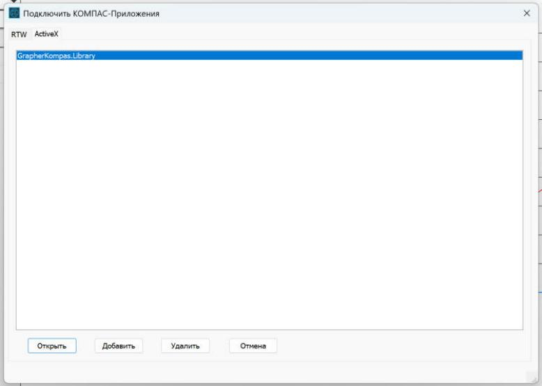

# Установка Grapher

Grapher строит графики по точкам в чертежах и фрагментах КОМПАС-3D. После установки
им можно пользоваться двумя способами:

- как отдельной программой — ярлык «Grapher» в меню «Пуск» и на рабочем столе;
- прямо из КОМПАС — меню «Приложения» → «Grapher» → «Построить график…».

Оба способа открывают одно и то же окно и строят одинаковые графики.

Страница программы, новые версии и исходный код: https://github.com/gbirkin3005/Grapher-Kompas

## Что нужно

- Windows 10 или Windows 11, 64-разрядная.
- КОМПАС-3D. Программа проверена на КОМПАС-3D v25 (учебная версия); на других версиях
  она не проверялась.
- .NET Framework 4.8. В Windows 10 (начиная с версии 1903) и в Windows 11 он уже есть.

Excel и Mathcad не нужны. Права администратора нужны, только если устанавливать программу
для всех пользователей компьютера.

## Установка

1. Скачайте мастер установки `Grapher-<версия>-setup.exe` со страницы Releases:
   https://github.com/gbirkin3005/Grapher-Kompas/releases (или возьмите у того, кто вам его
   передал).

2. Закройте КОМПАС-3D. Пока он запущен, мастер не сможет добавить Grapher в его меню:
   при выходе КОМПАС перезаписывает список своих приложений.

3. Запустите `Grapher-<версия>-setup.exe`.

   У мастера нет цифровой подписи, поэтому Windows может показать синее окно «Система Windows
   защитила ваш компьютер». Нажмите «Подробнее» → «Выполнить в любом случае».

4. Пройдите страницы мастера:

   - **Параметры установки.**
     - «Для кого установить»: «только для меня» (права администратора не нужны) или «для всех
       пользователей компьютера» (Windows попросит разрешения на изменения).
     - «Папка установки» — по умолчанию `%LOCALAPPDATA%\Programs\Grapher` (только для меня)
       или `C:\Program Files\Grapher` (для всех).
     - «Ярлыки Grapher» — в меню «Пуск» и на рабочем столе.
     - «Подключить Grapher к КОМПАС-3D» — флажок для каждой найденной версии КОМПАС
       (и редакции: учебная, Home и т. д.). Отметьте версии, в меню «Приложения» которых
       должен появиться Grapher. Версия, которую вы ещё ни разу не запускали, показана серым:
       у неё пока нет файла настроек, подключите Grapher к ней вручную (см. ниже) после её
       первого запуска.
   - **Всё готово к установке** — проверьте список действий и нажмите «Установить».
   - **Готово** — можно сразу запустить Grapher или открыть руководство пользователя.

5. Запустите КОМПАС-3D: в меню «Приложения» появится пункт «Grapher», а в нём — команда
   «Построить график…». Первая загрузка приложения может занять несколько секунд.

Что делает мастер:

- копирует программу в выбранную папку;
- регистрирует библиотеку КОМПАС (ветка реестра `HKCU\Software\Classes` для установки «только
  для меня», `HKLM\Software\Classes` — для всех пользователей);
- добавляет Grapher в список приложений отмеченных версий КОМПАС — файл
  `%AppData%\ASCON\KOMPAS-3D\<версия>\<редакция>.kit.config`; прежний файл сохраняется рядом
  с расширением `.grapher-backup`;
- создаёт ярлыки;
- добавляет Grapher в список установленных приложений Windows. В «Панели управления» →
  «Программы и компоненты» у него указаны издатель и ссылки «Сведения об обновлении»
  и «Ссылка справки» на страницу программы.

Список приложений КОМПАС у каждой учётной записи Windows свой. Мастер подключает Grapher
к КОМПАС только той учётной записи, под которой он запущен. При установке для всех
пользователей остальным достаточно подключить Grapher вручную — устанавливать программу
ещё раз не нужно.

## Подключение к КОМПАС вручную

Нужно, если версия КОМПАС не была отмечена в мастере, ещё не запускалась или была открыта
во время установки, а также для других учётных записей Windows. Это делается один раз:

1. Запустите КОМПАС-3D.
2. Откройте меню «Приложения» и выберите «Добавить приложения…».
3. Откроется окно «Подключить КОМПАС-Приложения». Перейдите в нём на вкладку «ActiveX»,
   щёлкните по строке `GrapherKompas.Library` и нажмите «Открыть».
4. В меню «Приложения» появится пункт «Grapher», а в нём — команда «Построить график…».



## Проверка

1. В КОМПАС откройте или создайте чертёж или фрагмент.
2. Выберите «Приложения» → «Grapher» → «Построить график…».
3. Введите в таблицу несколько точек, например X: 0, 1, 2, 3 и Y: 0, 1, 4, 9
   (переход в следующую ячейку — клавиша Tab). Справа появится предпросмотр графика.
4. Нажмите «Построить в КОМПАС» (или F5) и щёлкните мышью на чертеже.

На чертеже должен появиться график с осями, сеткой и числами. Щелчок по любой его линии
выделяет график целиком: он построен как один макроэлемент.

Готовые примеры данных лежат в папке `samples` в папке программы: `sqrt.xlsx`, `sqrt.csv`
и `sqrt.txt` — 100 точек функции y = √x. Они открываются командой «Файл» → «Импорт
из Excel/CSV…».

Как вводить свои данные и настраивать оформление, написано в руководстве пользователя
(в папке программы это файл «Руководство.txt», в репозитории — `docs/USAGE.md`).

## Обновление

Запустите мастер новой версии. Он найдёт установленную программу и предложит «Обновить
до версии …»; папка и вид установки сохраняются. Перед этим закройте КОМПАС и Grapher, иначе
файлы программы будут заняты. Настройки Grapher и подключение к КОМПАС сохраняются.

Узнать о новых версиях можно на странице программы: ссылка есть в окне Grapher «Справка» →
«О программе» и в «Программах и компонентах» Windows («Сведения об обновлении»).

## Удаление

1. Закройте КОМПАС и Grapher.
2. Откройте «Параметры» Windows → «Приложения» → «Установленные приложения» (или «Панель
   управления» → «Программы и компоненты»), найдите Grapher и выберите «Удалить».
3. В мастере удаления отметьте, что удалить, и нажмите «Удалить».

Удаляются папка программы, ярлыки, регистрация библиотеки и (если отмечено) пункт Grapher
в списке приложений КОМПАС всех версий. Настройки остаются в папке `%AppData%\Grapher`,
если не отметить «удалить также настройки программы».

Мастер удаления — это файл `Uninstall.exe` в папке программы; его можно запустить и напрямую.

## Установка из архива и запуск без установки

На странице Releases есть и архив `Grapher-<версия>.zip`. Отдельная программа работает
без установки: распакуйте архив («Извлечь всё…») и запустите `Grapher.exe` (КОМПАС при этом
должен быть установлен). Пункта в меню «Приложения» в таком случае не будет.

В архиве есть и прежний установщик без окон: `install.cmd` устанавливает программу только
для текущего пользователя (без подключения к КОМПАС — его нужно сделать вручную),
`uninstall.cmd` удаляет её. Мастер установки делает то же и больше, пользуйтесь лучше им.

## Установка без окон

Мастер понимает ключи командной строки — например, для установки на несколько компьютеров:

```
Grapher-1.2.1-setup.exe /silent [/allusers] [/dir=ПАПКА] [/nostartmenu] [/nodesktop] [/nokompas] [/log=ФАЙЛ]
Uninstall.exe /silent [/removesettings] [/nokompas] [/log=ФАЙЛ]
```

- `/allusers` — для всех пользователей (запускайте из командной строки администратора);
- `/nokompas` — не подключать Grapher к КОМПАС (при удалении — не трогать список приложений
  КОМПАС). Без этого ключа Grapher подключается ко всем установленным версиям КОМПАС, которые
  уже запускались от имени текущего пользователя;
- `/log=ФАЙЛ` — записать ход установки в файл.

Коды завершения: 0 — успешно, 1 — ошибка, 2 — файлы заняты (открыт КОМПАС или Grapher),
3 — отменено.

## Если что-то не получилось

**Мастер пишет, что КОМПАС-3D запущен.**
Закройте КОМПАС и нажмите «Повторить». Если нажать «Пропустить», программа установится,
но Grapher придётся подключить к КОМПАС вручную.

**Мастер пишет «Файл … занят».**
Закройте КОМПАС-3D и Grapher и запустите мастер ещё раз.

**В меню «Приложения» КОМПАС нет пункта «Grapher».**

- Проверьте, что версия КОМПАС была отмечена в мастере и что КОМПАС был закрыт во время
  установки. Если нет — подключите Grapher вручную (см. выше).
- Если на вкладке «ActiveX» нет строки `GrapherKompas.Library`: при установке «только
  для меня» регистрация действует только для той учётной записи, под которой запускался
  мастер. Если КОМПАС запущен «от имени администратора», он может не видеть регистрацию
  текущего пользователя — запустите КОМПАС обычным образом.

**Пункт «Grapher» в меню есть, но окно не открывается.**
Закройте КОМПАС и запустите мастер ещё раз («Обновить»): он заново копирует файлы программы
и записывает в реестр путь к библиотеке. Так же поступите, если вы переместили или
переименовали папку программы — Grapher нужно установить заново, а не переносить вручную.

**`Grapher.exe` или мастер не запускаются и просят установить .NET Framework.**
Установите .NET Framework 4.8: https://dotnet.microsoft.com/download/dotnet-framework/net48

**На чертеже вместо букв квадратики.**
В выбранном шрифте нет нужных знаков или сам шрифт не установлен. Grapher по умолчанию
пишет шрифтом «GOST Type AU», который ставится вместе с КОМПАС-3D v25. Выберите другой
шрифт в настройках оформления.
